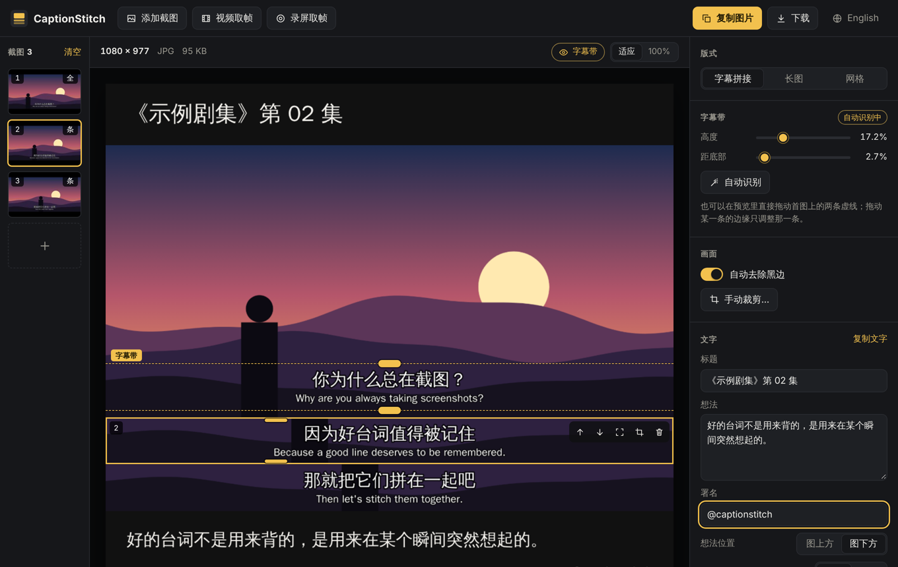

# CaptionStitch

把视频截图和对应的字幕拼成一张图，再配上你的想法，直接粘贴到社交媒体。

所有处理都在浏览器本地完成：不上传图片，不依赖任何网站或 CDN，断网也能用。

**在线使用：<https://anna-sap.github.io/CaptionStitch/>**（打开后点「用示例试试」即可体验）



## 怎么运行

**在线版：** 直接访问 <https://anna-sap.github.io/CaptionStitch/>，无需安装。图片同样只在你的浏览器里处理，不会上传。

**离线版：直接打开单文件版。** 用浏览器打开 [`release/CaptionStitch.html`](release/CaptionStitch.html) 即可。它是一个约 100 KB 的自包含文件，可以拷到任何地方、离线使用，也可以丢到任意静态托管上。

**本地开发：**

```bash
npm install
```

```bash
npm run dev
```

然后访问 <http://localhost:5173>。

**重新构建：**

```bash
npm run build
```

构建产物是 `dist/index.html`（JS 和 CSS 已全部内联），同时会更新 `release/CaptionStitch.html`。

**跑测试：**

```bash
npm test
```

需要 Node.js 20.19 或更高版本。

**在线部署：** 推送到 `main` 后，`.github/workflows/pages.yml` 会自动测试、构建并发布到 GitHub Pages，在线版随之更新。

## 怎么用

1. **放入截图**：拖入、点「添加截图」，或者截图后直接按 `Ctrl/⌘+V` 粘贴。一次放多张时按截图时间自动排序。
2. **看结果**：第一张保留完整画面，其余只留字幕条。黑边和字幕位置会自动识别，一般不用再调。
3. **需要时微调**：
   - 拖动首图上的两条虚线，统一调整所有字幕条；
   - 拖动某一条的上下边缘，只调整那一条；
   - 悬停（手机上点一下）某张图，可以上移、下移、展开为完整画面、裁剪或删除；
   - 左侧缩略图可以拖动排序。
4. **写想法**：在右侧填标题、想法、署名，它们会排进图片里。
5. **分享**：点「复制图片」（或 `Ctrl/⌘+C`）后直接粘贴到聊天或发帖框；也可以「下载」（`Ctrl/⌘+S`），手机上还有「分享」。

没有现成截图时：

- **视频取帧**：打开本地视频，逐帧挑选画面；「自动提取字幕帧」会播放一遍视频，字幕每换一句自动截一张。
- **录屏取帧**：录制正在播放的窗口，录制中可随时截取，停止后还能回看录像逐帧挑。

视频取帧的快捷键：空格 播放/暂停，`←/→` 前后 1 秒，`,` `.` 逐帧，`Enter` 截取。

## 比原工具多做了什么

CaptionStitch 借鉴了 [webp2jpg-online](https://github.com/renzhezhilu/webp2jpg-online) 里「视频字幕拼接工具」的思路（首图完整 + 其余只取字幕条），代码是独立重写的。围绕「又快又准地分享」，主要改进有：

| | 原工具 | CaptionStitch |
| --- | --- | --- |
| 字幕位置 | 手动调「字幕高度 / 偏移」两个滑块 | 自动识别字幕带；可在预览里直接拖线；每一条可单独调整 |
| 黑边 / 播放器边框 | 会被一起拼进去，需逐张裁剪 | 自动识别并去除，多张截图互相校验 |
| 导入 | 选择文件 | 拖入、粘贴、选择文件，按截图时间自动排序 |
| 视频 | 手动截图 | 手动逐帧截取，或按字幕换句自动截取 |
| 输出尺寸 | 默认按原图宽度（4K 截图会得到巨大的图） | 默认 1080 宽，可设文件大小上限并自动压缩 |
| 分享 | 下载文件 | 一键复制到剪贴板、系统分享、下载 |
| 想法 | 无 | 标题、想法、署名直接排进图片，文字可一并复制 |
| 依赖 | 需要在线加载脚本 | 单个 HTML 文件，完全离线 |
| 其他 | | 自动保存，刷新后恢复；删除可撤销；中英文界面；支持手机 |

原工具的长图、多列网格、间距、边距、圆角、背景色、JPG / PNG / WebP 输出等能力也都保留。

## 项目结构

```
src/
  core/
    layout.ts   拼接布局（纯函数）
    detect.ts   黑边与字幕带识别、字幕指纹（纯函数）
    text.ts     中英文混排换行（纯函数）
    render.ts   Canvas 绘制
    image.ts    图片导入与分析
    export.ts   编码、大小控制、复制、下载、分享
    store.ts    IndexedDB 会话存储
    demo.ts     内置示例图
  ui/           界面组件（Preact）
  state.ts      应用状态与操作
  i18n.ts       中英文文案
tests/          布局、识别、换行的单元测试
release/        构建好的单文件版
```

技术栈：Vite + Preact + TypeScript，运行时没有其他依赖。

## 已知限制

- 「复制图片」固定为 PNG（浏览器剪贴板的限制）；格式、质量和大小上限作用于「下载」和「分享」。
- 带版权保护（DRM）的视频在录屏时可能是黑屏，这种情况请改用播放器或系统截图，再粘贴进来。
- 自动识别针对的是画面下半部分、居中的浅色字幕。遇到识别不准的画面，手动拖一下即可，手动调整后不会再被自动覆盖。
